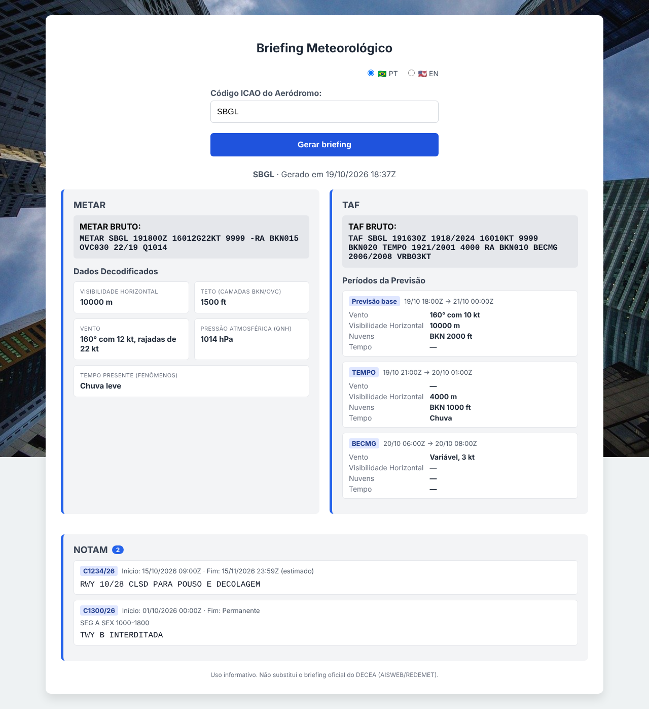

# 🌍 Briefing de Aeródromo / Aerodrome Briefing

A bilingual (English/Portuguese) briefing that shows the METAR, TAF and NOTAMs of an aerodrome on a single screen, in plain language.

Briefing bilíngue (português/inglês) que mostra METAR, TAF e NOTAM de um aeródromo numa tela só, em linguagem clara.


*(Imagem com dados de exemplo / Screenshot with sample data)*

An internationalized Web Application built to decode raw aeronautical meteorological reports (METAR) in real-time. Features a native toggle between English and Portuguese, rendering complex aviation data into a clean, modern UI.

Uma aplicação Web internacionalizada construída para decodificar relatórios meteorológicos aeronáuticos (METAR) em tempo real com alternância nativa de idioma entre Inglês e Português.

---

## 🚀 Live Demo / Demonstração ao Vivo
👉 **[https://app-metar.onrender.com](https://app-metar.onrender.com)**

<br>*(Note: Hosted on a free server tier, the initial load may take a few seconds).*</br>
<br>*(Nota: Por estar em um servidor gratuito, o primeiro carregamento pode demorar alguns segundos).*</br>

---

## 💡 Features / Funcionalidades

### 🇺🇸 English
- **Real-time Data Fetching:** Integrates with CheckWX API for updated global airport reports.
- **Internationalization (i18n):** Native language toggle (PT-BR / EN-US) processed in the backend.
- **Phenomenon Mapping:** Advanced dictionary that maps and translates raw aviation codes.
- **Responsive Grid UI:** Modern layout built with CSS Grid tailored for quick data reading.
- **Exception Handling:** Resilient logic for API drops, connection failures, or invalid ICAO codes.
- **METAR + TAF:** Current weather report and aerodrome forecast decoded side by side, following ICAO Annex 3 and DECEA's ICA 105-16. The METAR card covers CAVOK, wind variation, minimum visibility, RVR, all cloud layers with CB/TCU, recent weather, wind shear and the 2-hour trend. Each TAF period shows its change group and validity as written (e.g. `BECMG 2013/2015`, `PROB30 TEMPO 2018/2022`), plus issue time, validity and max/min temperatures (TX/TN).
- **NOTAMs in force:** Brazilian aerodromes, from DECEA's official AISWEB API.
- **Fault isolation:** The three sources are fetched in parallel; if one fails, the others still show.
- **Automated tests:** pytest suite with sample API responses.

### 🇧🇷 Português
- **Dados em Tempo Real:** Integração com a API CheckWX para relatórios atualizados de aeródromos globais.
- **Internacionalização (i18n):** Alternância nativa de idioma (PT-BR / EN-US) processada direto no backend.
- **Mapeamento de Fenômenos:** Dicionário avançado que mapeia e traduz códigos meteorológicos operacionais.
- **Interface Responsiva:** Layout moderno em CSS Grid feito para uma leitura rápida dos dados.
- **Tratamento de Exceções:** Lógica resiliente para quedas de API, falhas de conexão ou ICAO inválido.
- **METAR + TAF:** Boletim atual e previsão do aeródromo decodificados lado a lado, seguindo o Anexo 3 da ICAO e a ICA 105-16 do DECEA. O METAR mostra CAVOK, variação do vento, visibilidade mínima, RVR, todas as camadas de nuvens com CB/TCU, tempo recente, cortante do vento e a tendência para 2 horas. Cada período do TAF mostra o grupo de mudança e a validade como estão na mensagem (ex.: `BECMG 2013/2015`, `PROB30 TEMPO 2018/2022`), além de emissão, validade e temperaturas máxima e mínima (TX/TN).
- **NOTAM em vigor:** Aeródromos brasileiros, pela API oficial do AISWEB/DECEA.
- **Falhas isoladas:** As três fontes são consultadas em paralelo; se uma cair, as outras continuam aparecendo.
- **Testes automatizados:** Suíte pytest com respostas de exemplo das APIs.

---

## 🛠️ Tech Stack / Tecnologias Utilizadas

- **Backend:** Python, Flask, Requests, Python-Dotenv
- **APIs:** CheckWX (METAR/TAF), AISWEB/DECEA (NOTAM)
- **Tests / Testes:** pytest
- **Frontend:** HTML5, CSS3 (CSS Grid), Jinja2
- **Infrastructure / Infraestrutura:** Gunicorn, Render (Cloud Hosting & CI/CD)

---

## ⚙️ Running locally / Como rodar localmente

```bash
cd Projeto_METAR
pip install -r requirements.txt
python metar.py          # http://127.0.0.1:5000
python -m pytest         # testes / tests
```

`.env` (na pasta `Projeto_METAR` / inside `Projeto_METAR`):

```
API_KEY=sua_chave_checkwx
AISWEB_API_KEY=seu_apikey_aisweb
AISWEB_API_PASS=seu_apipass_aisweb
```

Sem as chaves do AISWEB o app funciona normalmente, só sem NOTAM. / Without the AISWEB keys the app still works, just without NOTAMs.

---

⚠️ Uso informativo. Não substitui o briefing oficial do DECEA. / For information only. Not a substitute for an official briefing.
